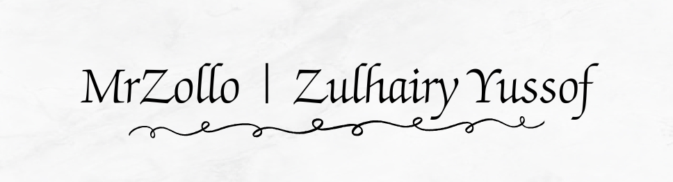

  

  

# Hi there, I'm MrZollo 👋 

🎓 **Student in Computer Science**  
🚀 **Major in Artificial Intelligence**  
💻 **VSCode Power User**

---

## 👨‍💻 About Me

- I’m currently a student specializing in IT/CS, with a strong passion for building solutions that matter.
- My main stack: **PHP** (Laravel is my go-to framework!)
- I love developing practical tools—everything from café management apps to robust e-commerce solutions.
- My favorite project? **Analysis Sistem For Malaysian Prison** — my final year project, and a real highlight of my learning journey.

---

## 🎓 Education
- **Bachelor's Degree in Computer Science, Major in Artificial Intelligence**
  Universiti Teknikal Malaysia Melaka, Malaysia
- **Diploma in Certified Information Systems Security Professional (CISSP 2019)**  
  1 years at a Alison School in Co Galway, Ireland
- **Diploma in Information Technology (Software & Application Development)**  
  Politeknik Mersing Johor, Malaysia
  
---

<picture>
  <source media="(prefers-color-scheme: dark)" srcset="https://raw.githubusercontent.com/huiishan99/huiishan99/output/github-contribution-grid-snake-dark.svg">
  <source media="(prefers-color-scheme: light)" srcset="https://raw.githubusercontent.com/huiishan99/huiishan99/output/github-contribution-grid-snake.svg">
  
</picture>  

---

## 📌 Featured Project

### 🏆 Prisoner Record and information System management
A comprehensive analysis solution designed to support the Malaysian prison system.  
*Built with PHP & Laravel.*

---

## 🛠️ Tech Stack

---

## 📫 Connect with Me

Find my social links on [my GitHub profile](https://github.com/MrZollo) — let’s connect!

---

Thanks for visiting my profile!  
Feel free to check out my repositories or reach out for collaboration 🚀
